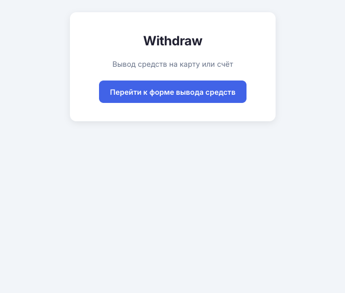
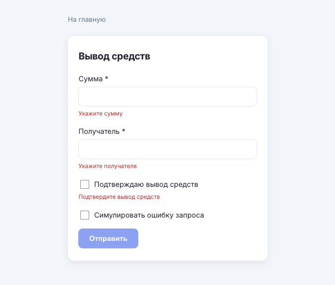
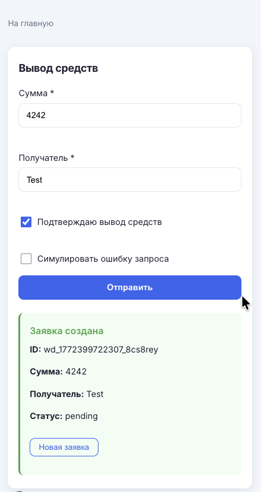
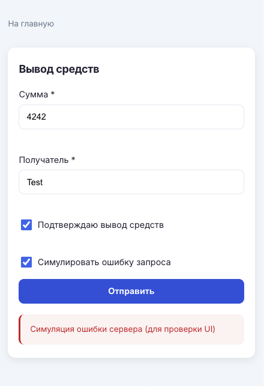

# Withdraw

Страница вывода средств: форма (сумма, получатель, подтверждение), отправка заявки в `API` с идемпотентным ключом, обработка ошибок (`409` и др.), `retry` при сетевой ошибке и при `5xx` без потери введённых данных, `AbortController` для отмены при уходе со страницы, защита от двойной отправки.

## Скриншоты

### Главная страница (desktop)



### Страница вывода (desktop)



### Успешная заявка (мобильная)



### Ошибка запроса (мобильная)



## Стек

- **React 19**
- **Next.js 16** (App Router)
- **TypeScript 5**
- **Zustand 5**

## Требования

- Node.js 20+
- npm

## Установка и запуск

```bash
npm install
npm run dev
```

Откройте [http://localhost:3000/](http://localhost:3000/).

Для первого запуска E2E-тестов установите браузер: `npx playwright install chromium`.

## Скрипты

| Команда              | Описание                      |
| -------------------- | ----------------------------- |
| `npm run dev`        | Режим разработки с hot reload |
| `npm run build`      | Production-сборка             |
| `npm run start`      | Запуск собранного приложения  |
| `npm run lint`       | Проверка кода (ESLint)        |
| `npm run test`       | Запуск тестов (Vitest)        |
| `npm run test:e2e`   | E2E-тесты (Playwright)        |
| `npm run test:watch` | Тесты в режиме watch          |

## Функциональность приложения

### Форма вывода

- Поля: **Сумма** (число > 0), **Получатель** (обязательная строка), чекбокс **Подтверждаю вывод средств**.
- Валидация в реальном времени; кнопка «Отправить» активна только при валидной форме.
- Во время запроса кнопка и поля отключены (состояние loading), отображается «Отправка…».

### Отправка заявки

- При отправке формируется идемпотентный ключ (UUID), передаётся в заголовке `Idempotency-Key`.
- Запрос: `POST /api/v1/withdrawals` с телом `{ amount, destination }`.
- При успехе (200) в сторе сохраняется созданная заявка, отображается блок «Заявка создана» с id, суммой, получателем и статусом.
- Защита от двойного submit: при статусе loading повторный клик не вызывает API (кнопка disabled и проверка в обработчике).

### Ошибки API

- **409** — показывается понятное сообщение (например «Заявка с таким ключом уже создана»).
- **Сетевая ошибка** (не удалось выполнить запрос) — до 3 попыток с задержкой 1 с; введённые данные не сбрасываются.
- **Ответ 5xx** (в т.ч. симулированная ошибка) — до 3 попыток с задержкой 1 с; после исчерпания попыток показывается ошибка, данные формы сохраняются.
- **Ответы 4xx** — один запрос, сообщение об ошибке отображается, данные формы сохраняются.

### Состояния UI

- **idle** — форма доступна.
- **loading** — запрос выполняется, форма и кнопка отключены.
- **success** — отображается созданная заявка и кнопка «Новая заявка» для сброса формы.
- **error** — отображается сообщение об ошибке, форма остаётся заполненной для повторной попытки.

## Данные / API

- **Создание заявки**: `POST /api/v1/withdrawals`
  Заголовки: `Content-Type: application/json`, `Idempotency-Key: <uuid>`.
  Тело: `{ "amount": number, "destination": string }`.
  Ответ 200: объект заявки (id, amount, destination, status, createdAt).
  Ответ 409: тело с полем `message` — показывается пользователю.

- **Получение заявки**: `GET /api/v1/withdrawals/{id}` — в текущей реализации данные заявки берутся из ответа POST; GET доступен в API для сценариев подгрузки по id.

В режиме разработки доступны мок-обработчики Next.js API Routes: [src/app/api/v1/withdrawals/route.ts](src/app/api/v1/withdrawals/route.ts) и [src/app/api/v1/withdrawals/[id]/route.ts](src/app/api/v1/withdrawals/%5Bid%5D/route.ts). Для работы с реальным бэкендом задайте `NEXT_PUBLIC_API_BASE` (например `https://api.example.com`).

## Безопасность и авторизация

- Access token **не хранится в localStorage**. Для мока можно задать опциональную переменную `NEXT_PUBLIC_MOCK_TOKEN` — она подставляется в заголовок `Authorization` только при запросах к API. В продакшене рекомендуется: выдача токена и хранение сессии на бэкенде, установка httpOnly cookie после входа; фронтенд не имеет доступа к токену, запросы к API идут с credentials (cookie) или через BFF.

## Структура проекта

```
├── src/
│   ├── app/
│   │   ├── layout.tsx
│   │   ├── page.tsx
│   │   ├── globals.css
│   │   ├── withdraw/
│   │   │   └── page.tsx
│   │   └── api/
│   │       └── v1/
│   │           └── withdrawals/
│   │               ├── route.ts          # POST (мок)
│   │               ├── mockStore.ts
│   │               └── [id]/
│   │                   └── route.ts      # GET (мок)
│   ├── api/
│   │   ├── config.ts                     # API_BASE, getAuthHeaders
│   │   └── withdrawalsApi.ts             # createWithdrawal, getWithdrawal, retry при сети и 5xx
│   ├── store/
│   │   └── withdrawStore.ts              # Zustand: форма, status, lastWithdrawal, error
│   ├── components/
│   │   └── WithdrawForm.tsx
│   ├── hooks/
│   │   └── useWithdrawSubmit.ts
│   ├── types/
│   │   └── withdrawal.ts
│   └── utils/
│       ├── idempotency.ts                # generateIdempotencyKey
│       ├── validation.ts                 # validateWithdrawForm, isWithdrawFormValid
│       └── lastWithdrawalStorage.ts      # persist/restore последней заявки (5 мин)
├── __tests__/
│   ├── unit/
│   │   ├── withdraw.test.tsx             # unit: форма, API, валидация, 409, loading, restore
│   │   └── lastWithdrawalStorage.test.ts  # unit: persist/restore, TTL
│   └── e2e/
│       └── withdraw.spec.ts              # E2E: отправка формы, проверка успеха
├── screenshots/
│   ├── main-page-desktop.png
│   ├── withdraw-page-desktop.png
│   ├── correct-request-mobile.png
│   └── error-request-mobile.png
├── package.json
├── next.config.ts
├── playwright.config.ts
├── tsconfig.json
└── vitest.config.ts
```

## Особенности реализации

- **Zustand**: единый store для полей формы, статуса (idle/loading/success/error), последней заявки и сообщения об ошибке. Защита от двойного submit: проверка `status === 'loading'` перед вызовом API и disabled кнопки.
- **Идемпотентность**: один UUID на одну логическую отправку.
- **Retry при сетевой ошибке и при 5xx**: до 3 попыток с задержкой 1 с; при 4xx повторов нет.
- **AbortController**: при размонтировании компонента запрос отменяется (abort); при AbortError состояние формы не обновляется.
- **Безопасный рендер**: вывод только текста и атрибутов, без `dangerouslySetInnerHTML`.
- **Семантика и доступность**: форма с `<form>`, `<fieldset>`, `<label>`, блок успеха с `role="status"`, блок ошибки с `role="alert"`.
- **Восстановление после reload**: последняя успешная заявка сохраняется в `localStorage`; при открытии страницы вывода в течение 5 минут отображается снова.
- **Производительность**: мемоизация компонентов (`React.memo`), производных значений и колбэков (`useMemo`, `useCallback`), селекторы Zustand с `useShallow` для снижения лишних рендеров.

## Тесты

- **Happy path**: отправка валидной формы → мок POST 200 → проверка отображения заявки и вызова API с idempotency key.
- **Ошибка API**: мок 500 (3 попытки retry) → проверка отображения сообщения об ошибке и сохранения введённых данных.
- **Двойной submit**: мок «висящий» до разрешения promise → два клика по кнопке → проверка, что POST вызван один раз.
- **Валидация (пустая форма)**: клик «Отправить» без заполнения → отображение ошибок по полям, fetch не вызывается.
- **Валидация (сумма ≤ 0)**: сумма 0 при заполненных остальных полях → ошибка «Сумма должна быть больше нуля», fetch не вызывается.
- **409**: мок 409 с сообщением «Заявка с таким ключом уже создана» → текст отображается в блоке с role="alert".
- **Loading**: после клика «Отправить» кнопка переходит в состояние «Отправка…» и disabled до завершения запроса.
- **Восстановление после reload**: при валидных данных в localStorage блок «Заявка создана» отображается без вызова API.
- **lastWithdrawalStorage**: unit-тесты persist/restore, истёкший TTL, невалидный JSON и структура.
- **E2E**: один сценарий Playwright: заполнение формы, отправка, проверка блока успеха. Запуск: `npm run test:e2e`.

Запуск unit-тестов: `npm run test`.
